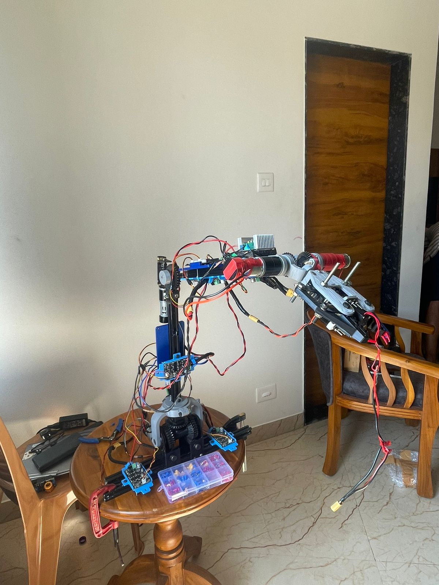
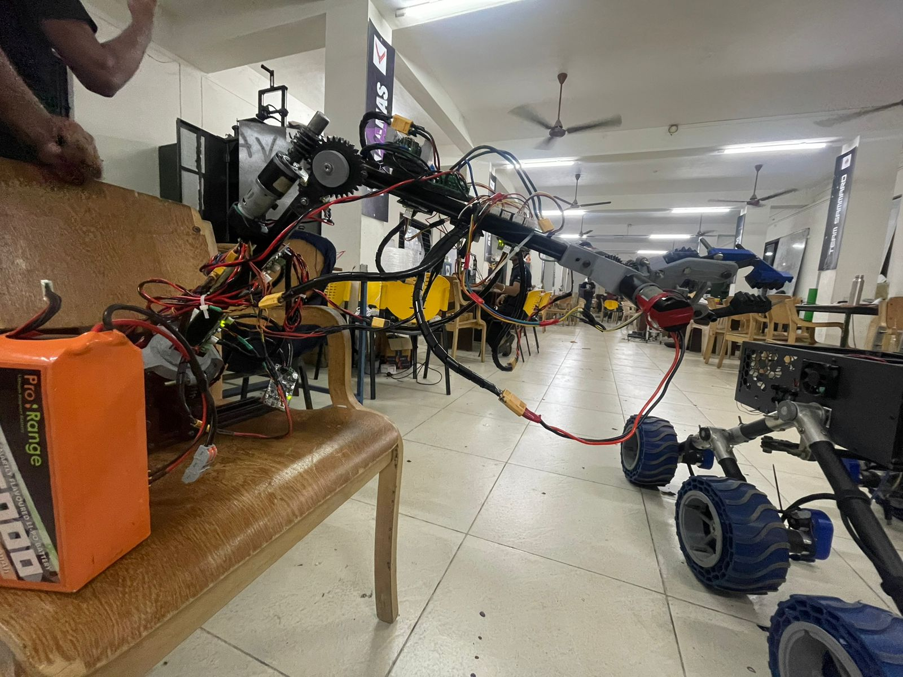
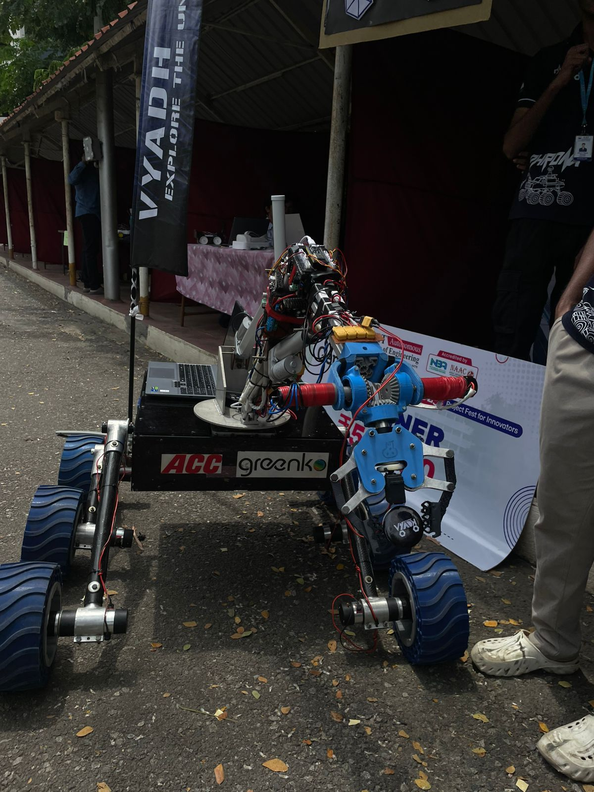
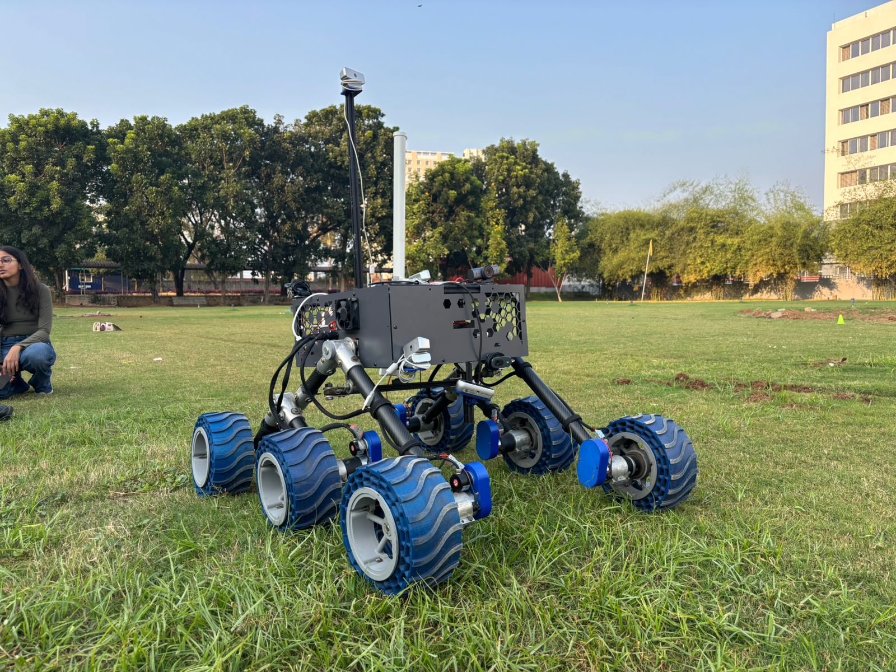
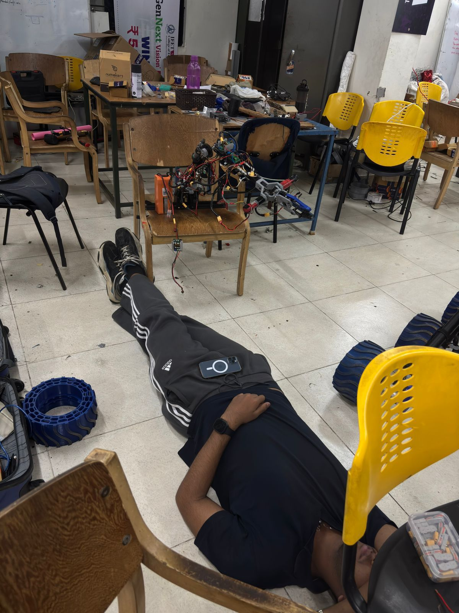
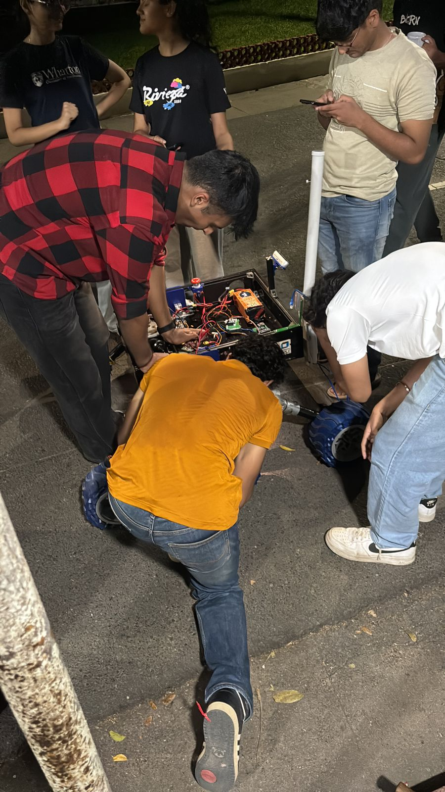
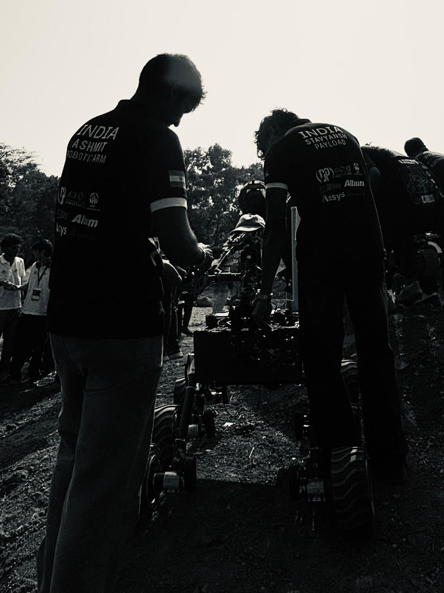

# Team Vyadh Robotic Arm

Robotic arm subsystem work for the Mars rover developed by **Team Vyadh, VIT Vellore**, organised by competition year.

| Year | Folder | Status |
|---|---|---|
| IRC26 | [`IRC26/`](IRC26/) | **Research, Development and Deployment stages** |
| IRC27 | [`IRC27/`](IRC27/) | **Under development** |

## Contents

1. [Repository layout](#repository-layout)
2. [IRC26: Research, Development and Deployment stages](#irc26-research-development-and-deployment-stages)
   - [Stage 1: Research](#stage-1-research)
   - [Stage 2: Development](#stage-2-development)
   - [Stage 3: Deployment](#stage-3-deployment)
   - [Software: ROS 2 manual control stack](#software-ros-2-manual-control-stack)
   - [Technologies used](#technologies-used)
3. [IRC27: Under development](#irc27-under-development)

---

## Repository layout

```text
Team-Vyadh-Robotic-Arm/
├── IRC26/                         Research, Development and Deployment stages
│   ├── encoder_system/            ESP32 encoder firmware + AS5600 encoder holder CAD
│   ├── homing_system/             Wrist differential limit-switch homing + CAD
│   ├── mounts/                    Motor driver, PCB retention and wire management mounts
│   ├── RobArm_ManualControl/      ROS 2 manual-control stack (Jetson + STM32 architecture)
│   ├── images/                    Arm, rover and team photographs
│   └── raw_imports/               Original photo archives (unprocessed)
└── IRC27/                         Under development
```

---

# IRC26: Research, Development and Deployment stages

The IRC26 robotic arm is a modular, multi-DOF manipulator built for Mars rover operations and field deployment. The work went through three stages: **researching** feedback and control approaches, **developing** the firmware and custom hardware, and **deploying** the result on the competition rover.

| Stage | Focus | Where |
|---|---|---|
| 1. Research | Encoder feedback architectures, resolution limits of ESP32 processing | [`IRC26/encoder_system`](IRC26/encoder_system) |
| 2. Development | Wrist homing, custom mounts, firmware, ROS 2 control software | [`IRC26/homing_system`](IRC26/homing_system), [`IRC26/mounts`](IRC26/mounts), [`IRC26/RobArm_ManualControl`](IRC26/RobArm_ManualControl) |
| 3. Deployment | Integration on the rover and competition operation | [`IRC26/images`](IRC26/images) |

---

## Stage 1: Research

### Encoder feedback systems

Closed-loop joint control needs reliable position feedback. Several encoder approaches were explored for **IG32 DC encoded motors** using **ESP32-based interrupt processing**:

| Approach | Description |
|---|---|
| **9048 CPR magnetic encoder** | Interrupt-driven quadrature decoding for IG32 motors with 9048 CPR magnetic encoders. Lightweight, used for precise joint positioning. |
| **~232,464 CPR optical encoder** | Experimental evaluation of ultra-high-resolution feedback (about 232,464 counts per revolution including the gearbox) on an ESP32 alone, using the `FastInterruptEncoder` library. |
| **Hybrid architecture** | Motor encoders combined with **AS5600 magnetic absolute encoders**, giving both relative and absolute joint position for better feedback reliability. |

**Firmware** ([`IRC26/encoder_system/firmware`](IRC26/encoder_system/firmware)):

| File | Purpose |
|---|---|
| `IG32_9048COUNT.ino` | 9048 CPR magnetic encoder handling |
| `IG32_2LAKHCOUNT.ino` | High-CPR (~232k) optical encoder handling |
| `magneticandopticalencoder.ino` | Optical and generic quadrature encoder read together |
| `multi_encoder.ino` | Multi-encoder configuration (optical + magnetic) |

**CAD** ([`IRC26/encoder_system/cad`](IRC26/encoder_system/cad)): `encoderholder_base.stl` and `enco holder.stl`, the AS5600 mounting hardware, designed for precise magnet alignment, stable sensor positioning and vibration resistance.

More detail: [`IRC26/encoder_system/README.md`](IRC26/encoder_system/README.md)

---

## Stage 2: Development

### Wrist differential homing system

**Problem.** The wrist differential has no direct encoder feedback, so without a reference position its orientation can drift between operation and startup.

**Solution.** A limit-switch homing routine establishes a repeatable zero:

1. On startup the wrist moves toward the homing position.
2. The limit switch is triggered.
3. The controller takes this position as the calibrated zero.

A custom switch holder (`final_limitswitchholder.stl`) positions the switch accurately and tolerates vibration.

More detail: [`IRC26/homing_system/README.md`](IRC26/homing_system/README.md)

### Mechanical mounting infrastructure

Custom 3D-printed mounts designed for vibration resistance, modularity, compact integration and deployment reliability.

| Mount | File | Purpose |
|---|---|---|
| **MD10C motor driver mount** | `Motor driver box 13-1-26 final.3mf` | Stable retention of Cytron MD10C drivers during arm motion |
| **PCB retention mount** | `pcb_mount.stl` | Holds the custom PCB/protoboard with controlled sliding tolerances, preventing displacement and easing servicing |
| **Wire management** | `unorthodoxwiremanagerv2.stl` | Cable routing that reduces interference and entanglement during articulation |

These mounts were used on the final competition arm.

More detail: [`IRC26/mounts/README.md`](IRC26/mounts/README.md)

### Arm assembly and bench integration

<table>
  <tr>
    <td align="center"><br><sub>Arm on the bench during electronics integration and testing</sub></td>
    <td align="center"><br><sub>Arm with wiring and electronics being assembled and integrated onto the rover</sub></td>
  </tr>
</table>

### Software: ROS 2 manual control stack

[`IRC26/RobArm_ManualControl`](IRC26/RobArm_ManualControl) is a ROS 2 manual-control stack for the 7-channel arm. A **Jetson Orin Nano** runs ROS 2 and sends motion requests; an **STM32 NUCLEO-F446ZE** owns ramping, the command watchdog and motor safety.

| Package | Role |
|---|---|
| `arm_interfaces` | Message definitions |
| `arm_teleop` | Keyboard to `/arm/user_input` |
| `arm_control` | Intent to validated `/arm/command`, state monitor |
| `arm_hardware` | Mock and serial bridges, protocol, fake STM32 |
| `arm_bringup` | Launch files and YAML configs |

> **Status:** the ROS-side code is written but has only been tested in plain Python with a fake ROS harness. It has not yet been built with `colcon`, no STM32 firmware has been written, and nothing has been tested on hardware. Polarity, limits and timeouts are placeholders. See [`IRC26/RobArm_ManualControl/README.md`](IRC26/RobArm_ManualControl/README.md) and [`HOW_TO_RUN.md`](IRC26/RobArm_ManualControl/HOW_TO_RUN.md).

---

## Stage 3: Deployment

The arm was integrated onto the rover and operated under real field conditions.

### Rover and arm in the field

<table>
  <tr>
    <td align="center"><br><sub>Rover with the robotic arm mounted, at the Vyadh stall</sub></td>
    <td align="center"><br><sub>Rover on open grass terrain</sub></td>
  </tr>
</table>

### Team in action

<table>
  <tr>
    <td align="center"><br><sub>Hardware preparation and repair</sub></td>
    <td align="center"><br><sub>Team working on the rover electronics</sub></td>
    <td align="center"><br><sub>Team with the rover during field operation</sub></td>
  </tr>
</table>

### What was delivered

- Precise joint positioning with encoder-based feedback
- Repeatable wrist homing and calibration
- Modular electronics integration
- Vibration-resistant mounting for the competition platform

---

## Technologies used

| Area | Tools |
|---|---|
| Embedded systems | ESP32, interrupt-driven encoder interfaces, AS5600, Arduino framework |
| Robotics and control | Closed-loop feedback, joint calibration, differential wrist mechanism, ROS 2 Jazzy, Jetson Orin Nano, STM32 |
| Mechanical design | Fusion 360, 3D-printed subsystem hardware, modular mounts |

---

# IRC27: Under development

> 🚧 **Under development.** Work for IRC27 has not been added yet; this folder is a placeholder. See [`IRC27/`](IRC27/).
